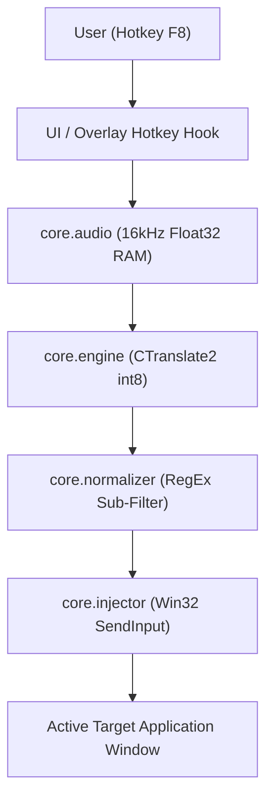

# 🏛️ Whisper Pill Pro – Architecture & Engine Spec

**Version:** 2.1.0 (Performance & Modular Edition)  
**Location:** `C:\Users\UserS2025\Desktop\Development\whisper-code`

---

## 🎯 System Overview

Whisper Pill Pro is an ultra-fast, zero-cloud floating HUD for Windows that provides local Speech-to-Text via `faster-whisper` (CTranslate2 int8).

---

## 📦 Core Modules (`src/whisper_pill/`)

| Module | Purpose | Performance / Reliability Pattern |
| :--- | :--- | :--- |
| `core/hardware.py` | Detects CPU architecture & thread topology. | Binds inference to P-Cores on Intel Raptor Lake to avoid E-Core cache thrashing. |
| `core/config.py` | Dataclass `AppConfig` + JSON persistence. | Default `beam_size = 1` for ultra-fast greedy decoding without CPU penalty. |
| `core/engine.py` | CTranslate2 Whisper lifecycle & inference. | Silero VAD tuned to 400ms silence / 200ms pad; zero-disk RAM transcription. |
| `core/audio.py` | `sounddevice` InputStream capturing into RAM. | Pure NumPy float32 buffer; no temporary WAV files written to disk. |
| `core/injector.py` | Native Windows clipboard & keystroke injector. | MSDN-standard `SendInput` structs with 64-bit alignment (`ULONG_PTR`). Focus restored before `Ctrl+V`. |
| `core/guard.py` | Security Guard (Agentic OWASP 2026). | Audio buffer validation against NaN/Inf poisoning and model ID white-listing. |
| `ui/overlay.py` | Floating Tkinter window (Catppuccin Mocha). | Thread-safe async worker dispatch (`root.after`), always-on-top, sheen pulse. |
| `ui/sounds.py` | Non-blocking audio feedback. | Asynchronous `winsound.PlaySound` threads for Start, Stop, Ready, and Processing. |

---

## ⚡ Performance Matrix (Intel Raptor Lake / 12 Threads)

* **Greedy Decoding (`beam_size = 1`):** ~2-3x speedup compared to beam search.
* **Silero VAD Gating:** Discards non-speech leading/trailing silence automatically.
* **Peak Normalization:** Keeps signal volume balanced for high int8 accuracy without hallucination loops.
